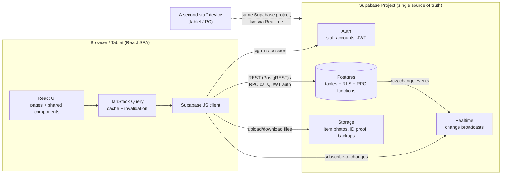
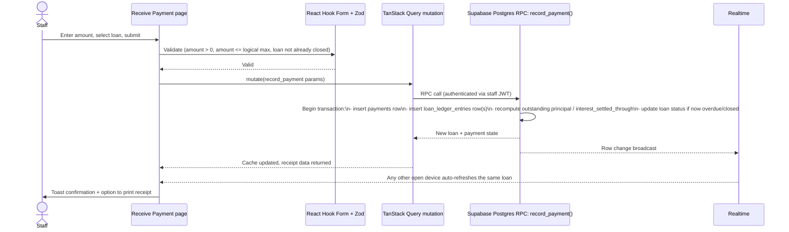

# Application Architecture & Data Flow

## Summary

This is a **serverless single-page application**: a React SPA talks directly to
Supabase (hosted Postgres + Auth + Storage + Realtime) over HTTPS. There is no
custom backend server to deploy, patch, or scale — Supabase *is* the backend.
Business-critical mutations (anything that touches money — payments, loan closure,
principal reduction) are routed through **Postgres functions (RPCs)**, not raw
table writes, so that the database — not the client — is the single point of truth
for financial correctness, even when two shop devices write at the same time.

## Why this shape

- **Multiple devices share one cloud database** (a hard requirement): Supabase
  Postgres is the single shared store; every device — whether the owner's laptop or
  a counter tablet — reads and writes the same project. No local-only state for
  anything financial.
- **No custom server** keeps operational burden near zero for a small shop business —
  nothing to patch, no server to go down independently of the database.
- **Row Level Security (RLS)**, not application code, is the real authorization
  boundary. The browser only ever holds the Supabase *anon* public key — safe to
  expose because RLS policies (scoped by the signed-in staff user's role) decide what
  that key can actually read or write. The `service_role` key (which bypasses RLS)
  is never sent to the browser — see [07-environment-variables.md](./07-environment-variables.md)
  and [08-security-threat-checklist.md](./08-security-threat-checklist.md).
- **Postgres RPC functions for money-moving actions** (`record_payment()`,
  `close_loan()`, etc. — see [02-database-schema-erd.md](./02-database-schema-erd.md))
  wrap the ledger update + balance recalculation + status change in one atomic
  transaction. This is what prevents a race where two devices recording a payment
  for the same loan within seconds of each other could corrupt the outstanding
  balance — the function serializes on the loan row.
- **Realtime subscriptions** let a second device see a loan flip to "paid this month"
  or "closed" within seconds, without a manual refresh — important when, e.g., the
  owner is on a laptop doing reports while a staff member is at the counter
  recording payments.

## Layers

| Layer | Responsibility | Where |
|---|---|---|
| Presentation | Pages, forms, tables, charts — no business math | `src/features/*`, `src/components/*` |
| Client state/cache | Server-state caching, invalidation, retries | `src/app/query-client.ts`, TanStack Query hooks in `src/hooks` (Phase 2) |
| Domain logic (pure) | Interest/ledger math, validation schemas — framework-free, unit-tested | `src/lib/calculations`, `src/lib/validators` |
| Data access | Supabase client, typed queries/RPC calls | `src/lib/supabase` |
| Backend (managed) | Auth, RLS-enforced Postgres, Storage, Realtime | Supabase project (see [02-database-schema-erd.md](./02-database-schema-erd.md)) |

The **domain logic layer is deliberately framework-free**: the interest calculation
in [04-interest-calculation.md](./04-interest-calculation.md) must be implementable
and unit-testable as a plain TypeScript function (and, for the parts that must be
race-safe, as a Postgres function) — not something that only works wired into React.

## Data flow: a representative request (recording a payment)

## Environments

Local development, staging, and production are **three separate Supabase projects**
(not schemas within one project), so a bug in staging can never touch real customer
money or data. Each environment gets its own `.env` (never committed — see
[07-environment-variables.md](./07-environment-variables.md)) pointing at its own
project URL/keys. Schema is kept in sync across environments via the versioned SQL
migrations in `supabase/migrations/`, applied with the Supabase CLI.

## Out of scope for this architecture (explicitly deferred)

- A native mobile app — the SPA is responsive and installable as a PWA if needed
  later, but no App Store/Play Store artifact is planned.
- Multi-branch / multi-shop tenancy — the schema in
  [02-database-schema-erd.md](./02-database-schema-erd.md) is deliberately
  single-shop for now; see that doc's "Future scaling note" for what would change.
- Offline-first support — the app assumes shop wifi/mobile data is available;
  no offline queue/sync is designed in Phase 0–4.
